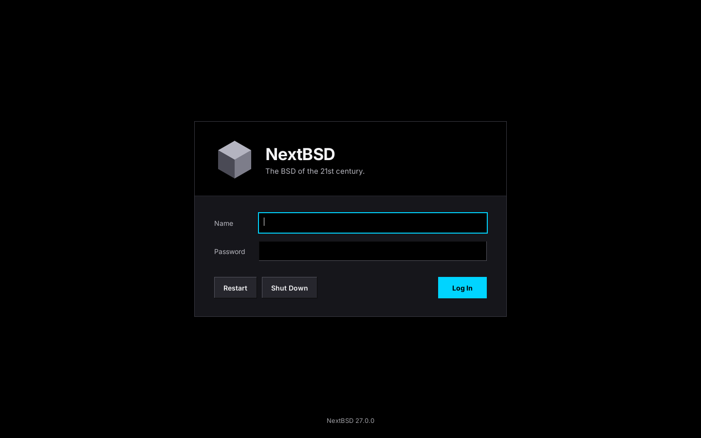

# apps-loginwindow

loginwindow for NextBSD: the graphical login on the NextBSD [WindowServer](https://github.com/pkgdemon/apps-windowserver).

It shows one login panel on a black screen, checks the name and password with PAM, and starts the user's desktop session. When the session ends it cleans up and shows the panel again.

This is a proof of concept.



Captured from a headless WindowServer with `wsctl snapshot`.

## What it is

- A GNUstep app, `loginwindow.app`, that runs as root. It is a client of WindowServer through the GNUstep `nextbsd` backend.
- A LaunchDaemon, `org.nextbsd.loginwindow`. Its plist is installed inside the app; enabling the graphical login copies it to `/System/Library/LaunchDaemons`.
- A PAM service, `/etc/pam.d/loginwindow`.

The panel is drawn by loginwindow itself to the NextBSD Desktop Theme design. It doesn't use the GNUstep theme, because it runs as root and should look the same on every machine. The text is Inter.

## Building and installing

On NextBSD, with the GNUstep core libraries, the `nextbsd` backend and WindowServer installed:

```sh
. /System/Library/Makefiles/GNUstep.sh
gmake
gmake install        # as root; DESTDIR=... works
```

| What | Where |
|---|---|
| App | `/System/Library/CoreServices/loginwindow.app` |
| LaunchDaemon plist | `/System/Library/CoreServices/loginwindow.app/Resources/org.nextbsd.loginwindow.plist` |
| PAM service | `/etc/pam.d/loginwindow`, only if there isn't one yet |

## Trying it

From a text console (not from X), as root:

```sh
/usr/libexec/WindowServer/ws-session start
/System/Library/CoreServices/loginwindow.app/loginwindow
```

Or let launchd run it, the way it will at boot:

```sh
/usr/libexec/WindowServer/ws-session start
launchctl load -F /System/Library/CoreServices/loginwindow.app/Resources/org.nextbsd.loginwindow.plist
```

`launchctl unload` on the same file stops it. That also ends a session that is running. `ws-session stop` gives the console back.

To try it without a display, start a private headless server and point loginwindow at it with `WS_SERVICE_NAME`. See the [WindowServer README](https://github.com/pkgdemon/apps-windowserver#trying-it-without-a-display).

## Logging in

Type the name, then Tab and the password, then Return or click Log In. An account without a password logs in with an empty one, as on the text console. A wrong password shakes the panel and clears the password.

Restart and Shut Down ask once more in the panel itself: the first click changes the button to "Confirm Restart" or "Confirm Shut Down", and a second click within five seconds runs `/sbin/shutdown -r now` or `/sbin/shutdown -p now`.

### PAM

loginwindow uses its own service, `loginwindow`. It is NextBSD's `login` stack without two lines:

- `pam_self` would let anyone log in as root without a password, because loginwindow itself runs as root.
- `pam_launchd` is left out because launchd Aqua sessions don't work on NextBSD yet (nextbsd-userland#372).

## Sessions

After a good login, loginwindow hides the panel and starts the session straight away, with no animation:

1. It forks a child that calls `setsid()`, so the session gets its own session id, and `setusercontext(LOGIN_SETALL)`, which sets the groups, uid, resource limits, umask, `PATH` and the login class environment. It sets `HOME`, `USER`, `LOGNAME` and `SHELL`, adds the PAM environment, and changes to the home folder.
2. The child runs `Resources/session` with `/bin/sh`. The script sources `GNUstep.sh` and starts `gdnc --no-fork` and `gpbs --no-fork`, so both stay in the session. Then it starts the session apps.
3. The apps are listed in `~/Library/LoginWindow/SessionApps` if that file exists, or else in the app's `Resources/SessionApps`, which lists InnerSpace and FileViewer. They are looked for in `~/Applications`, `/System/Applications`, `/Local/Applications` and `/Network/Applications`. The last app runs in the foreground. When it quits, the session ends, like `.xinitrc` under X today.

The session's output goes to `~/Library/Logs/LoginWindowSession.log`.

### Choosing the WindowServer backend

Session apps must use `libgnustep-nextbsd` without loginwindow changing the user's own defaults, and with unmodified GNUstep libraries. Passing `-GSBackend` on the command line isn't an option, because Terminal runs its arguments as a shell command.

libs-base reads its configuration file from `GNUSTEP_CONFIG_FILE` when that is set. It also merges `GlobalDefaults.plist` from the same folder into the `GSConfigDomain` defaults. So, for every login, loginwindow writes `/var/run/loginwindow/GNUstep/`:

- `GNUstep.conf`, a copy of the system `/System/Library/Preferences/GNUstep.conf`, so all paths stay the same
- `GlobalDefaults.plist`, the system one (if any) plus `GSBackend = libgnustep-nextbsd`

It then sets `GNUSTEP_CONFIG_FILE` to that `GNUstep.conf` for the session. Nothing is written to the user's defaults.

`GSConfigDomain` comes after the user's `NSGlobalDomain`. If a user has set `GSBackend` there themselves, to another backend, that would still win. Only in that case does the session script save the old value in `~/Library/Preferences/.loginwindow-GSBackend`, switch it to `libgnustep-nextbsd` for the session, and put it back when the session ends. If a session doesn't end cleanly, the next login puts it back first.

loginwindow selects the backend for itself in code. Before AppKit loads a backend, it puts `GSBackend`, the default fonts and the plain GNUstep theme in its own argument domain, so root's defaults can't change them.

### Ending a session

loginwindow waits for the session leader (the script) to exit. It then stops every process in the session: `SIGTERM`, up to three seconds for them to quit, then `SIGKILL` for anything left. Then it closes the PAM session and shows the panel again, cleared.

A process belongs to the session if it is in the session's Unix session (the session id) or descends from the session leader. loginwindow makes itself a reaper with `procctl(2)`, so processes that daemonize or call `setsid()` are still found. Other processes of the same user, such as SSH logins, are never touched.

### Leftovers

loginwindow keeps a record of each running session in `/var/run/loginwindow/<uid>.session`: the user, uid, session id and every member pid with its start time. It updates the record every two seconds. If loginwindow crashes or is killed, launchd starts it again. Before the next session starts, the new loginwindow stops whatever the old records name and removes them. The start times guard against reused pids.

## Fonts and artwork

Inter Regular, SemiBold and Bold are in `Resources/Fonts`. loginwindow adds that folder to fontconfig as application fonts at startup, so it doesn't depend on fonts installed system-wide (root has none on the arm64 test VM). Nothing is added to the system's fonts.

The cube comes from `NextBSD.png` in [nextbsd-theme](https://github.com/pkgdemon/nextbsd-theme), cropped to the cube and scaled for the 84 px header box.

## Booting to loginwindow

[nextbsd-gnustep](https://github.com/pkgdemon/nextbsd-gnustep)'s `enable-loginwindow.sh` makes the machine boot to the login panel: it enables WindowServer's LaunchDaemon and copies this plist into `/System/Library/LaunchDaemons` and loads it. `disable-loginwindow.sh` undoes both. loginwindow waits up to a minute for WindowServer to answer, with backoff, and exits if it doesn't; launchd then starts it again.

An installed `org.nextbsd.loginwindow.plist` tells NextBSD a graphical login owns the console: `org.nextbsd.getty` stays off `ttyv0`, and console automatic login and the banner stand down. That needs nextbsd-userland#606; until it's in your NextBSD build, getty only steps aside for Gershwin's loginwindow.

## License

BSD 2-Clause. See [LICENSE](LICENSE).

- Inter is under the SIL Open Font License 1.1. Its license is in [Resources/Fonts/OFL.txt](Resources/Fonts/OFL.txt). The fonts are the unmodified Inter 4.1 files from [rsms/inter](https://github.com/rsms/inter), as bundled in nextbsd-theme.
- The cube artwork comes from [nextbsd-theme](https://github.com/pkgdemon/nextbsd-theme), which is BSD 2-Clause by the same author.
